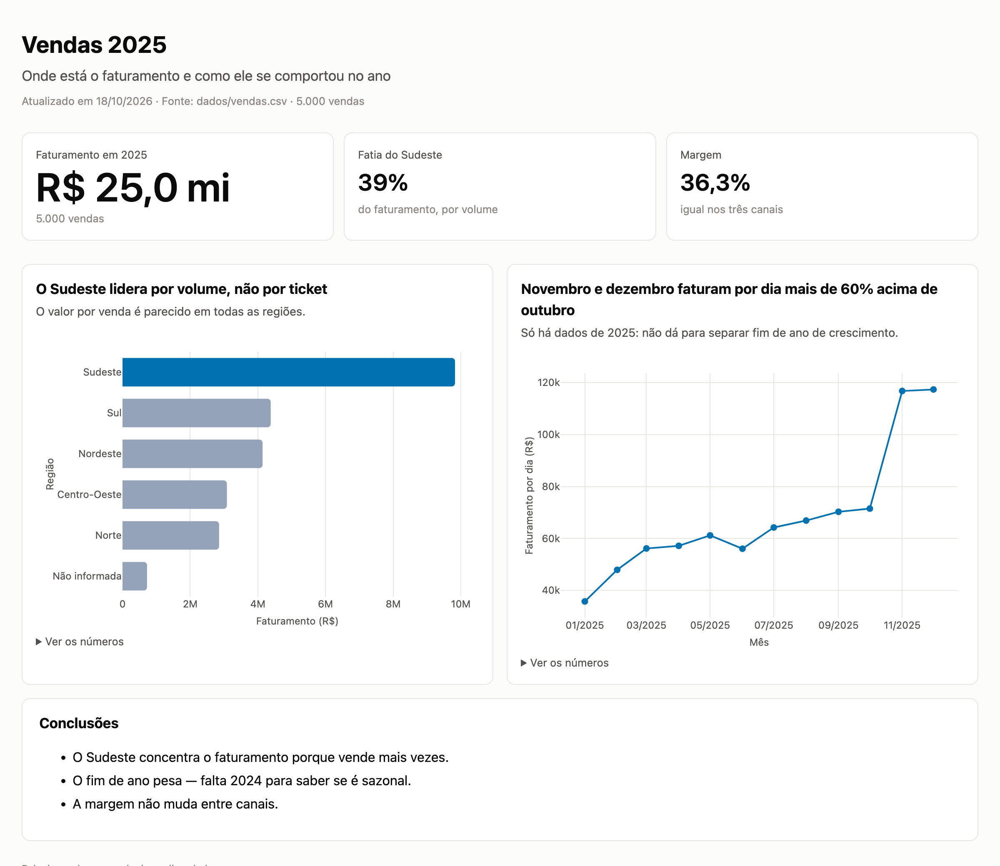
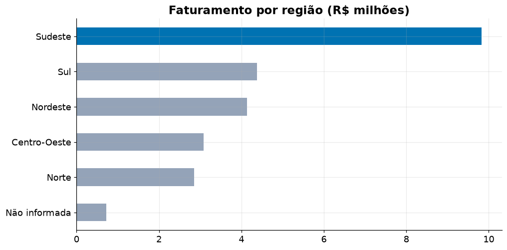
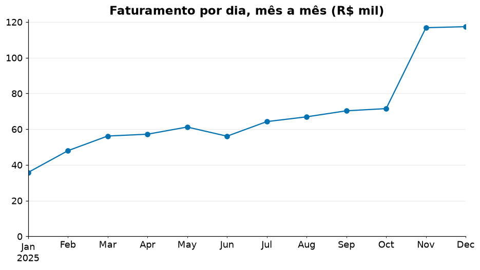
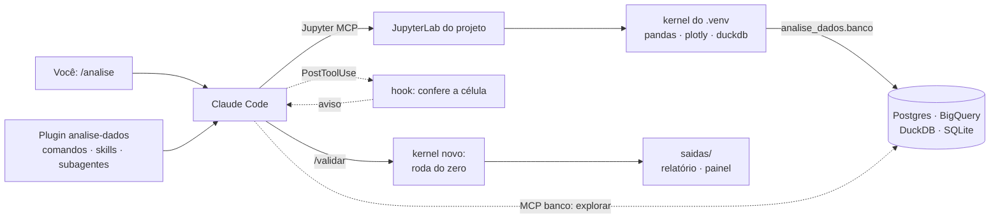

# analise-dados — análise de dados com IA que um gestor consegue usar

[](https://github.com/fernandofigueiredo-data/analise-dados-plugin/actions/workflows/ci.yml)
[](LICENSE)

Plugin do [Claude Code](https://code.claude.com) que conduz uma análise de dados em Jupyter **uma pergunta por
vez**: cada resultado passa por uma revisão crítica antes de virar conclusão, o
notebook é provado rodando do zero, e o que sai no fim (relatório e painel) é
escrito para quem decide, não para quem programa.



## O problema

Pedir uma análise a um assistente de IA costuma render um notebook que **parece**
pronto e não é:

- **células enormes**, cheias de lógica empilhada e comentários óbvios — ninguém revisa;
- **conclusões mais fortes que os dados**: concentração lida como risco, pico de
  fim de ano chamado de crescimento, associação vendida como causa;
- **notebooks que só funcionam no kernel de quem escreveu** — rodados do zero, quebram;
- **texto em jargão** ("análise bivariada", "outliers") que a área de negócio não usa.

Instruções no prompt não resolvem: o modelo esquece no meio da análise.

## A solução

O método vira **regra executada pelo sistema**, não sugestão:

| Onde | O que garante |
|---|---|
| Hook `PostToolUse` em cada célula gravada | Código com mais de 10 linhas ou `$` sem escape no markdown → o Claude é avisado na hora e corrige |
| Skills `revisao-critica` e `qualidade-dados` | Antes de interpretar: o `n` está visível? é share ou risco? é sazonalidade? os dados têm buracos? |
| Subagente `revisor` (só lê) | Relê a análise pronta e aponta conclusões que não se sustentam, com célula, trecho e correção |
| `/validar` | Roda o notebook num kernel novo, de cima a baixo, e confere as regras no notebook inteiro — inclusive soma por mês sem ajuste pelos dias e taxa sem contagem |
| Subagente `editor` + `/relatorio` + `/painel` | Texto em linguagem de negócio; HTML sem código; painel interativo offline |
| Permissões do projeto | `dados/` não pode ser editado; o `.env` (senhas de banco) não pode ser lido pelo Claude |

## Resultado no projeto de exemplo

[`exemplo/analise.ipynb`](exemplo/analise.ipynb) analisa um conjunto de exemplo
com 5.000 vendas de 2025 para responder **onde está o faturamento**. Os três achados,
como o método obrigou a escrevê-los:

| Pergunta | Achado | O que a revisão crítica mudou |
|---|---|---|
| Qual região fatura mais? | Sudeste, com 39% do faturamento | Mostrou que é **volume, não ticket**: o valor por venda fica entre `R$ 4,7 mil` e `R$ 5,2 mil` em todas as regiões |
| O faturamento muda no ano? | Nov–dez faturam **por dia** mais de 60% acima de outubro | Comparação por dia (meses têm tamanhos diferentes) e a ressalva: **só há 2025**, não dá para separar sazonalidade de crescimento |
| Algum canal dá mais margem? | Não: ~36% nos três canais | `n` visível (mais de mil vendas por canal) antes de afirmar igualdade |

<p>
  
  
</p>

O mesmo notebook também registra a decisão de tratamento (154 vendas sem região
mantidas como "Não informada", em vez de apagadas) em
[`exemplo/contexto.md`](exemplo/contexto.md), a memória que a próxima sessão lê.

## Com e sem o plugin

A mesma pergunta, os mesmos dados, o mesmo ambiente e o mesmo modelo
(`claude-sonnet-5-5`): uma sessão sem o plugin e outra com ele, em duas rodadas.
Os notebooks foram medidos pelo mesmo script e julgados às cegas, cada par nas
duas ordens. Protocolo, notebooks gerados e dados brutos em
[`comparacao/`](comparacao/).

| | Sem plugin | Com plugin |
|---|---|---|
| Nota no julgamento cego, rodada 1 (plugin v1.0.0) | 8 · 8 | 7 · 7 |
| Nota no julgamento cego, rodada 2 (plugin v1.1.0) | 6 · 6 | 9 · 8 |
| Meses ajustados pelos dias (R1 · R2) | não · não | não · **sim** |
| Roda do zero num kernel novo | sim | sim |
| Linhas por célula, média (R1 · R2) | 9,8 · 9,5 | 3,3 · 3,6 |
| Textos com `$` que quebra a renderização (R1 · R2) | 4 · 2 | 0 · 0 |
| Contexto registrado · validado na própria sessão | não · não | sim · sim |
| Custo por sessão (mesmo tempo, ~2,5 min) | ~US$ 0,57 | ~US$ 0,80 |

**Leitura honesta:**

- **A rodada 1 virou melhoria.** Os dois lados compararam meses pelo total sem
  ajustar pelos dias, e o avaliador deu um ponto a mais à versão sem plugin. As
  duas falhas que escaparam — meses sem ajuste e taxa sem contagem — passaram a
  ser checadas por código no `/validar` (v1.1.0). Na rodada 2, o `/validar`
  apontou a soma mensal e a própria sessão corrigiu a tabela e a interpretação.
- **No conteúdo, vantagem moderada.** Média de 7,75 com o plugin contra 7,0 sem.
  Parte da distância da rodada 2 é variação do lado sem plugin, que caiu de 8
  para 6 por conta própria.
- **Na forma e na rastreabilidade, a vantagem se repetiu nas duas rodadas:**
  células revisáveis, nenhum texto quebrado para a diretoria (sem o plugin, o
  principal achado da rodada 1 aparece assim no Jupyter:
  "R9,83mi,∗∗2,2vezes∗∗oSul…") e decisões registradas para a próxima sessão.
  O custo é cerca de 40% maior.

## Evidências técnicas

| O que foi medido | Resultado |
|---|---|
| Início do servidor Jupyter MCP | **~125 s → 2,6 s**. A causa era o servidor esperando 120 s por um Jupyter que ainda não existia; resolvido com `START_NEW_CODE_SANDBOX=false` |
| Kernel usado pelas células | Corrigido: um kernel `python3` do usuário ganhava do kernel do projeto e rodava as células no Python do sistema, sem as dependências |
| Testes | 28 testes de unidade (regras de casa e da revisão crítica, hooks, preparação do projeto, configuração de banco) + teste de fumaça que executa uma célula pelo Jupyter MCP |
| CI | Passa em **Linux, macOS e Windows**: bootstrap do ambiente, ciclo pelo Jupyter MCP, `/validar` sem avisos, `/relatorio`, `/painel` e validação estrita dos manifestos (status no selo acima) |
| Sessão real do Claude Code | Plugin carregado com `--plugin-dir`: regras injetadas no início, hook disparando nas duas regras, Jupyter desligado ao fechar |
| Somente leitura nos bancos | `DELETE` bloqueado num arquivo DuckDB, tanto pela biblioteca do notebook quanto pelo servidor MCP. No Postgres, a conexão abre com transação somente leitura (sem teste contra banco real — ver limitações) |

## Como funciona



O ambiente Python de todos os projetos vem do `uv.lock` do plugin: atualizar o
plugin atualiza as dependências de cada projeto na próxima execução.

## Instalar e usar

Pré-requisito único: [`uv`](https://docs.astral.sh/uv/) (nem Python precisa).

```bash
claude plugin marketplace add fernandofigueiredo-data/analise-dados-plugin
```

```bash
claude plugin install analise-dados@analise-dados
```

Numa pasta com seus dados em `dados/`, abra o Claude Code e digite `/analise`.

| Comando | O que faz |
|---|---|
| `/analise` | Prepara a pasta e o ambiente, sobe o Jupyter, lê o `contexto.md` e conduz a análise |
| `/banco` | Liga o projeto a Postgres, BigQuery, DuckDB ou SQLite (a senha fica no `.env`, preenchido por você) |
| `/revisar` | Revisor crítico + editor de linguagem de negócio |
| `/validar` | Roda o notebook do zero e aponta erros e desvios das regras |
| `/relatorio` | `saidas/relatorio-analise.html`, sem código |
| `/painel` | `saidas/painel.html`, interativo e offline |

O plugin fica instalado para o usuário, mas só age em pastas de análise (com
`dados/`, `contexto.md` ou notebooks). Para ativar em um projeto só, use
`--scope project` na instalação.

## Decisões técnicas

- **Plugin em vez de pasta-modelo.** A primeira versão era um template copiado
  para cada projeto; corrigir uma regra exigia recopiar tudo. Como plugin,
  regras, skills e ambiente atualizam em todos os projetos. Custo: plugins não
  carregam `CLAUDE.md`, então as regras entram por um hook `SessionStart`.
- **Hook em vez de instrução.** O tamanho de célula e o escape de `$` são checados
  por código (`scripts/regras.py`), o mesmo usado pelo `/validar`. O que exige
  julgamento (share ou risco, causalidade) fica nas skills e no revisor.
- **MCP para explorar, notebook para analisar.** O servidor MCP de banco deixa o
  Claude descobrir tabelas e colunas, mas todo número de uma conclusão vem de uma
  célula — é o que o `/validar` refaz do zero.
- **Conectores de banco:** o `postgres-mcp` está quebrado no PyPI (depende de uma
  versão inexistente do `pglast`); o [`mcp-alchemy`](https://github.com/runekaagaard/mcp-alchemy)
  cobre Postgres, BigQuery e SQLite com a mesma `DB_URL` do notebook, mas falha
  com DuckDB — para ele, `mcp-server-motherduck`, que já abre somente leitura.
- **Painel só em fundo claro.** A paleta categórica (Okabe–Ito, segura para
  daltônicos) passou no validador de contraste no modo claro e falhou no escuro;
  como o painel é um documento para circular, ficou só o modo claro, com tabela
  de valores em cada gráfico para não depender só da cor.

## Limitações conhecidas

- **Postgres e BigQuery não foram testados contra um banco real** — só a
  configuração gerada e o caminho completo com DuckDB e SQLite.
- **Fechar uma sessão desliga o Jupyter** das outras sessões abertas no mesmo projeto.
- **O hook em `edit_cell_source` é melhor esforço**: a ferramenta devolve só um
  diff; o `/validar` cobre o notebook inteiro no fim.
- **Só o que é checado por código é garantido.** Tamanho de célula, `$`, soma
  por mês sem ajuste e taxa sem contagem são conferidos pelo hook ou pelo
  `/validar`; o resto da revisão crítica depende de o modelo seguir a skill — na
  [comparação](comparacao/), a versão com plugin da rodada 2 deixou a margem de
  fora e arredondou uma faixa de valores excluindo uma região.
- Textos, comandos e regras estão em **português**.

## Estrutura

```
.claude-plugin/marketplace.json   ← o repositório é um marketplace
plugins/analise-dados/
├── REGRAS.md                     ← regras de casa (hook SessionStart)
├── commands/ skills/ agents/     ← 6 comandos · 6 skills · 2 subagentes
├── hooks/hooks.json              ← regras no início · checagem de célula · desliga o Jupyter
├── .mcp.json                     ← Jupyter MCP com versão fixada
├── ambiente/                     ← pyproject.toml + uv.lock dos projetos
├── lib/analise_dados/            ← banco (SQL) e painel (Plotly), usados no notebook
└── scripts/                      ← bootstrap, validar, relatorio, banco, hooks
exemplo/                          ← projeto completo que o CI executa
tests/                            ← testes de unidade e teste de fumaça do MCP
```

## Desenvolver

```bash
claude --plugin-dir ./plugins/analise-dados
```

```bash
uv run --no-project --python 3.12 -m unittest discover -s tests -v
```

```bash
claude plugin validate --strict plugins/analise-dados
```

Para publicar uma versão, suba `version` em
`plugins/analise-dados/.claude-plugin/plugin.json`. Para trocar a versão do
Jupyter MCP, edite `plugins/analise-dados/.mcp.json` e confira a compatibilidade
de `jupyterlab` e `jupyter-collaboration` em `ambiente/pyproject.toml` — o passo
do Jupyter MCP no CI pega a quebra.

## Licença

[MIT](LICENSE)
