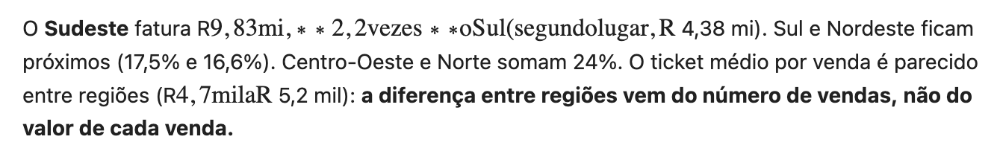
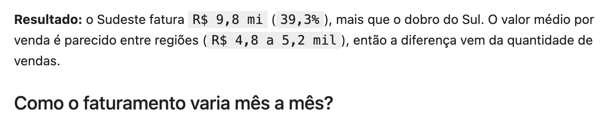

# Com e sem o plugin

Uma sessão do Claude Code analisou os mesmos dados, com a mesma pergunta de
negócio, uma vez **sem** o plugin e uma vez **com** ele. Depois os dois
notebooks foram medidos pelo mesmo script e julgados às cegas.

## Protocolo

| | Sem plugin | Com plugin |
|---|---|---|
| Dados | `vendas.csv` (5.000 vendas de 2025) | o mesmo arquivo |
| Ambiente Python | `.venv` com as mesmas versões (`uv.lock` do plugin) e kernel registrado | criado pelo próprio plugin, do mesmo `uv.lock` |
| Contexto de negócio | [`prompts/contexto.md`](prompts/contexto.md) | o mesmo texto |
| Instrução | [`prompts/sem-plugin.md`](prompts/sem-plugin.md): criar, executar e concluir o notebook | [`prompts/com-plugin.md`](prompts/com-plugin.md): seguir o `/analise` e o `/validar` |
| Modelo | `claude-sonnet-5-5` (padrão da sessão headless) | o mesmo |
| Pasta | isolada, sem nenhum `.mcp.json` ou `CLAUDE.md` acima | isolada, idem |

O projeto sem plugin recebeu um ambiente que funciona — inclusive o kernel do
`.venv` registrado —, para não falhar por um problema de ambiente que o plugin
resolve e que não é o que está sendo comparado.

**Medição** ([`medir.py`](medir.py)): roda cada notebook do zero num kernel
novo e mede a forma. **Avaliação cega** ([`preparar_avaliacao.py`](preparar_avaliacao.py)
+ [`rubrica.md`](rubrica.md)): cada notebook vira texto com rótulo A ou B
sorteado; uma sessão sem o plugin responde 10 perguntas verificáveis sem saber
qual é qual. O mapa (`A = com plugin`, `B = sem plugin`) só foi aberto depois.

## Resultados

### Conteúdo analítico — avaliação cega

| Pergunta da rubrica | Sem plugin | Com plugin |
|---|---|---|
| Números que não batem com os resultados | 0 | 0 |
| Causa afirmada sem evidência | 0 | 0 |
| Pico de fim de ano lido como tendência | não | não |
| Meses comparados sem ajustar pelos dias | **sim** | **sim** |
| Tamanho da base (`n`) visível | às vezes | às vezes |
| Explica se a liderança vem de volume ou de ticket | sim | sim |
| Diz o que fez com as 154 vendas sem região | sim | sim |
| Termos de jargão (segundo o avaliador) | 2 | 1 |
| Conclusão responde às três partes e é acionável | sim | sim |
| **Nota de confiabilidade (0–10)** | **8** | **7** |

[`resultados/avaliacao-cega.json`](resultados/avaliacao-cega.json) traz a
justificativa do avaliador.

### Forma, legibilidade e rastreabilidade — medição

| Métrica | Sem plugin | Com plugin |
|---|---|---|
| Roda do zero num kernel novo | sim | sim |
| Linhas por célula de código (média / máximo) | 9,8 / 16 | 3,3 / 8 |
| Células com mais de 10 linhas | 5 | 0 |
| Textos com `$` que quebra a renderização | **4** | 0 |
| Avisos das regras de casa | 9 | 0 |
| Decisões e contexto registrados (`contexto.md`) | não | sim |
| Validado do zero dentro da própria sessão | não | sim |
| Tempo da sessão | 2,6 min | 2,6 min |
| Custo da sessão | US$ 0,58 | US$ 0,79 (+35%) |

Como a diretoria leria o principal achado de cada um no Jupyter:

**Sem plugin** — o `$` de "R$" abre uma fórmula e o texto entre dois valores vira matemática:



**Com plugin** — os valores vão entre crases (regra de casa conferida por hook):



## O que isso mostra

- **No conteúdo, empate.** Com um modelo atual, a análise básica já sai correta
  sem o plugin: números certos, sem causa inventada, ressalva de sazonalidade,
  volume separado de ticket. O avaliador cego deu 8 à versão sem plugin e 7 à
  versão com plugin — diferença de um ponto, numa única execução.
- **Na forma e na rastreabilidade, vantagem clara do plugin.** Células curtas o
  bastante para revisar, nenhum texto quebrado para o leitor, o contexto e as
  decisões gravados para a próxima sessão, e o notebook provado do zero antes
  de ser entregue. Sem o plugin, quatro dos textos principais da análise chegam
  quebrados à diretoria.
- **Onde o plugin falhou.** A regra de comparar meses por dia está na skill
  `revisao-critica`, mas não foi aplicada; e o `n` não aparece em todas as
  tabelas. A revisão crítica depende de o modelo seguir a skill — não é
  conferida por código, como o tamanho das células.
- **Custo:** 35% a mais, no mesmo tempo, por causa dos passos extras (preparar
  o ambiente, validar, registrar o contexto).

## Limitações deste experimento

- **Uma execução de cada lado e um único julgamento.** Respostas de modelo
  variam entre execuções; a diferença de um ponto na nota cabe nessa variação.
- **O avaliador é o mesmo modelo** que fez as análises.
- **A rubrica e os "fatos dos dados" foram escritos por quem conhece os dados**
  e o plugin; as perguntas são verificáveis, mas a escolha delas não é neutra.
- **As métricas de forma são os critérios do próprio plugin** — é esperado que
  ele vá melhor nelas. A métrica neutra (rodar do zero) empatou.

## Reproduzir

Com o Claude Code e o `uv` instalados, em duas pastas novas com `dados/vendas.csv`:

```bash
PATH="$PWD/.venv/bin:$PATH" JUPYTER_PATH="$PWD/.venv/share/jupyter" claude -p "$(cat prompts/contexto.md; echo; cat prompts/sem-plugin.md)" --output-format json --max-turns 80 --allowedTools "Read,Write,Edit,NotebookEdit,Glob,Grep,Bash(python *),Bash(python3 *),Bash(jupyter *),Bash(.venv/bin/*),Bash(ls *)" > sem.json
```

```bash
claude -p "$(cat prompts/contexto.md; echo; cat prompts/com-plugin.md)" --plugin-dir <repo>/plugins/analise-dados --output-format json --max-turns 120 --allowedTools "Read,Write,Edit,Glob,Grep,Skill,Agent,Bash(uv *),Bash(.venv/bin/*),Bash(ls *),mcp__plugin_analise-dados_jupyter__*" > com.json
```

(Os caminhos de `prompts/` são relativos a esta pasta `comparacao/`; ajuste-os ao rodar de dentro da pasta de cada experimento.)

Depois, em cada pasta, `uv run --no-project --python .venv <repo>/comparacao/medir.py analise.ipynb <sessao>.json`,
e para a avaliação cega `preparar_avaliacao.py` seguido de `claude -p "$(cat rubrica.md)"`
na pasta gerada. A pasta sem plugin precisa do `.venv` antes (ver o protocolo acima).
